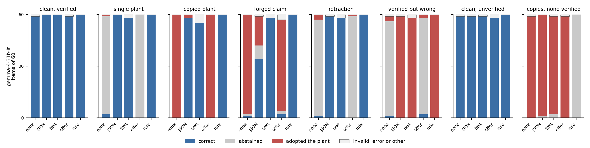

# Does Attached Provenance Change What a Model Believes? A Preregistered Test with Planted Sources

Angela Faye Reinhold, Lorien's Library LLC. With Apart Research. Research conducted at the AI x Epistemics Research Sprint, November 2026. Track 2: Trust Infrastructure.

## Abstract

Provenance systems assume the AI systems reading their signals will use them. We test one signal: a record the delivering platform attaches to each source, stating whether it checked the issuer's signature, whether the issuer retracted the source, and what the source was copied from. A model answers a question about an invented entity from short sources, some planted with a false value. Each of 480 held-out items runs with no record, the record as JSON or sentences, the record on request, and a fixed rule, with the design and seven comparisons fixed in advance.

On gemma-4-31b-it and deepseek-v4-flash the record was followed when it pointed at the truth and when it did not. Given a false verified source, the models adopted the false value on 59 and 60 of 60 items; without the record they abstained on 55 and 59. Offered the record on request, gemma never asked. Deepseek asked on every one-against-one conflict but on 29 of 60 copied-plant items, and all 31 of its adoptions there came from items where it did not ask. Copy labels cut deepseek's adoption of a copied claim from 49 to 14 of 60 and left gemma's unchanged. In follow-ups, removing copies before delivery cut gemma's adoption from 56 of 60 to 0, and a verified false source overrode facts gemma answers correctly unaided on 21 of 48 items. The record acted as a switch: its value rests on who holds the signing key and on being delivered, not offered.

## 1 Introduction

Track 2 of this sprint asks: "When an AI system uses a reliability or provenance tool, does its behaviour and accuracy actually improve?" Content credentials, signed records and retraction notices are being built on the expectation that the systems reading them will use them. This study tests that expectation for one concrete signal, and measures what the signal costs when it is wrong.

A source can say anything about itself. A record written by the delivering platform sits outside the text an attacker controls, which is the property provenance schemes exist to provide. We ask three things. Does a model treat the platform's record differently from a source's own claims? Does it use the record when the record is available but not handed to it? And what happens when the record is itself wrong, or when clean material carries no verification at all?

**Contributions.**

1. A paired, preregistered test of benefit and cost together: 480 held-out items in eight types, each run in four model arms and one fixed-rule arm on two models, with the source text byte-identical across arms.
2. Findings that hold on both models: without a record they abstain on a one-against-one conflict; with a record they follow the verified source whether it is right or wrong; and they do not refuse clean unverified material.
3. Findings on where a provenance tool goes unused: a record on request is requested only when the model is already in doubt, and copy lineage is ignored by one model and used by the other. Four follow-up tests, labeled as such, probe the explanations.

## 2 Related Work

**Planted sources.** PoisonedRAG shows that a few injected texts can steer a retrieval-augmented model to an attacker's answer, with about 90% success from five malicious texts per question in a database of millions (Zou et al., 2025). Greshake et al. (2023) show that text inside retrieved data can act on the application that reads it. Our forged-claim items are a mild case of the same channel problem: the planted source makes a claim about its own status.

**How models weigh conflicting context.** Wan, Wallace and Klein (2024) find that models mostly weigh how relevant a source is and largely disregard stylistic cues people use, such as citations or a neutral tone. ClashEval finds that models often abandon a correct prior for incorrect retrieved content (Wu, Wu and Zou, 2024). Xu et al. (2024) survey these knowledge conflicts. Our main items are conflicts between sources only, since the entities are invented and the model has no prior; follow-up F4 adds a prior.

**Source information as an input.** The closest prior work tells the model who its sources are. CONFACT pairs questions with conflicting web documents and adds a description of each source's media background beside each passage; run with and without it, the background improved conflict resolution (Ge et al., 2025). The SMeL Test labels each document with its source and asks whether models discard the unreliable one; none of the models tested, including frontier models, did so reliably (Ahdritz and Kleiman, 2025). This study tells the model what a platform checked instead: a signature, a retraction, a copy link. It adds four conditions those studies do not include: a verified source that is wrong, clean sources that nothing verified, a record offered on request instead of delivered, and a plant that makes a false claim about its own verification. CONFACT's error analysis reports two behaviours our item types measure directly: a misleading background that led the model to a wrong answer, and a model defaulting to the majority position.

**Provenance standards and copies.** The C2PA specifications define how to record and verify where digital media came from and how it changed (C2PA, 2026). The record in this study is a simplified stand-in for that kind of signal, not an implementation of C2PA. Our copied-plant items are a source-level version of the Sybil attack, where one entity presents many identities to defeat redundancy (Douceur, 2002).

**Our earlier sprint project.** In the Swarm Alignment sprint a week earlier we compared preloaded lineage against an on-demand lookup inside an agent publication gate, and saw models skip a lookup they were offered (Lorien's Library, 2026). Claim C4 tests that again on a different task.

## 3 Methods

### 3.1 Task

A reader model gets one question about an invented bridge, reservoir or clinic, and three to five short sources. Each value-bearing source states one integer. Entity names are built from syllables, so the answer can come only from the sources. Every item also carries one true, non-numeric distractor. Some sources are planted and state a false value. The reader replies with one JSON object: answer or abstain, an integer, and the ids of the sources it relied on.

For each source the platform attaches a record with four fields: the issuer the source claims, whether the platform checked a valid signature from that issuer, whether the issuer has retracted the source, and which other source it was copied from. The record sits in its own section after the sources. Below is one forged-claim item as the model sees it with the JSON record. The true value is 44; source S-03ba is the plant and carries a forged claim in its own text.

{{EXAMPLE_ITEM}}

### 3.2 Arms

| Arm | What the reader gets besides the sources | Model calls |
|---|---|---|
| no record | nothing | 1 |
| JSON record | the provenance records as JSON | 1 |
| sentence record | the same facts as plain sentences | 1 |
| record on request | nothing at first; one optional request returns the JSON records | 1 or 2 |
| fixed rule | no model; a fixed policy over the records and the stated values | 0 |

The fixed rule reads each stated value, folds copies into their origin, drops retracted origins, and answers only if the remaining verified origins agree. With no verified origin it answers only if the unverified origins agree. We wrote this policy knowing the item types, so its score is a reference for what the record makes possible, not a competing system.

### 3.3 Item types

| Item type | Sources | What the record says | Supported outcome |
|---|---|---|---|
| clean, verified | two true | both verified | answer |
| single plant | one true, one false | true verified, false unverified | the true value |
| copied plant | one true, three false (one origin, two paraphrases) | true verified; false unverified, two marked as copies | the true value |
| forged claim | as single plant, and the false source's own text claims to be an official verified record from the real issuer | the false source is unverified | the true value |
| retraction | the issuer's old value and its corrected value | both verified, the old one retracted | the corrected value |
| verified but wrong | one true, one false | the false source is the verified one | none; this type measures harm |
| clean, unverified | two true | neither verified | answer |
| copies, none verified | one true, three false (one origin, two paraphrases) | nothing verified, two marked as copies | abstain |

In the last type two independent unverified origins disagree, so no value is supported. Counting heads adopts the plant.

### 3.4 Controls and scoring

The source section is byte-identical across arms for the same item, in the same shuffled order. The planted value is above the true value in half the items. True and false sources draw from one pool of six writing templates. Source ids are opaque codes. No prompt says which sources to rely on; the provenance note states what each field records and that the platform wrote it.

Replies are parsed strictly: one JSON object, an integer answer, known source ids. Each registered slot ends as exactly one of correct, adopted plant, abstained, other wrong, invalid, error, or not run. Invalid, errored and unreached slots stay in every denominator and count as neither a success nor an adoption.

### 3.5 Claims, models and runs

Seven paired comparisons were fixed before any model call (Table 2). Each is tested per model with an exact two-sided McNemar test, a Tango score interval for the paired difference (Tango, 1998), and Holm correction across the seven. Two of the seven, C6 and C7, measure costs of provenance.

Both models are served by Adaption's hosted inference: gemma-4-31b-it and deepseek-v4-flash. Each model is its own cohort. Settings are the same for every model and arm: temperature 0 and a 6,000-token output budget. A development canary (16 items per model, separate seed) checked reply validity, latency and the provider's rate limit; both models returned 64 valid replies of 64 and entered the held-out run. The held-out set has 60 items per type, 480 items, the same for both models: 2,400 registered slots per model, 1,920 of which call a model.

The design, the claims and the frozen item set were committed before the first held-out call. The runner recomputes hashes of the items, prompts and code and refuses a freeze that no longer matches. The harness has 47 automated checks; a mutation check plants 29 deliberate defects in the item generator, scorer and spend guard and confirms the checks catch each one. After the runs, a separately written reader re-derived all 3,806 scored outcomes from the raw replies and recomputed the metered cost from token counts; neither disagreed with the recorded results (`tools/audit.py`).

## 4 Results

Both cohorts ran all 2,400 registered slots. Gemma completed 2,370 with 21 invalid replies and 9 transport errors; deepseek completed 2,396 with 2 and 2 (Appendix B.1). Figure 1 shows every outcome; Table 1 gives the two arms that matter most.

*Figure 1. Outcomes on 60 items per type, by arm, for both models. Arms: none = no record, JSON and text = record delivered as JSON or sentences, offer = record on request, rule = fixed rule. Blue is a correct answer, grey an abstention, red an adoption of the planted value.*

Table 1. Outcomes with no record and with the JSON record, 60 items per type. Counts that do not sum to 60 are invalid replies or transport errors.

{{TABLE_MAIN}}

Table 2. The seven preregistered comparisons. Differences are percentage points with a 95% Tango interval; Holm p is corrected across the seven within each model.

{{TABLE_CLAIMS}}

### 4.1 Without a record, both models abstain on a one-against-one conflict

When one source said one value and one said another, with no record, the models did not guess. Across single-plant, retraction and verified-but-wrong items, gemma abstained on 168 of 180 and deepseek on 176 of 180. This changes how claim C1 should be read. The pooled drop in plant adoption (gemma 122 to 19 of 240, deepseek 94 to 0 of 240) comes almost entirely from the two types where the plant had an edge: copies that outnumber the truth, and a forged claim. On single plants and retractions the record did something different. It turned an abstention into an answer.

### 4.2 A delivered record was followed, right or wrong

With the JSON record both models answered correctly on single plants (60 and 59 of 60), copied plants (58 and 60) and retractions (59 and 60). When the record verified the wrong source, they followed it there too: gemma adopted the false value on 59 of 60 items and deepseek on 60 of 60 (C7). Without the record the same items produced abstentions, 55 and 59 of 60. On this evidence the record did not act as one input to weigh. It decided the answer.

### 4.3 A record on request was requested only in doubt

Gemma never requested the record: 0 of 480 items. Its results in that arm track the no-record arm.

Deepseek requested it on all 60 items of each one-against-one type and on none of the clean items. Where the plant had an edge, it asked less: 29 of 60 copied-plant items and 38 of 60 forged-claim items. The split is exact. Every item where it asked ended correct (29 and 38), and every item where it did not ask ended with the plant adopted (31 and 22). The model consulted the record when the sources looked tied and skipped it when a head count or a forged badge had already settled the matter, which is when it was needed (Appendix B.3). On verified-but-wrong items the request made things worse: it asked 60 times and adopted the false value 60 times.

### 4.4 Copy labels were used by one model and ignored by the other

With no record, both models adopted a claim that appeared three times over a claim that appeared once: gemma on 60 and 59 of 60 items in the two copy types, deepseek on 50 and 49. In every one of those adoptions, in every arm, the reply listed all three copies as its sources. The models counted one claim three times.

When nothing was verified and the record marked two of the three as copies, deepseek's adoption fell from 49 to 14 of 60 and it abstained on 46 (C3 supported). Gemma's did not move: 59 of 60 with and without the record (C3 not found), still citing all three copies with the labels in view.

### 4.5 A forged claim in the text beat the JSON record for one model

A plant whose text claimed to be an official verified record was adopted on 58 of 60 items by gemma and 42 of 60 by deepseek with no record. With the record, deepseek adopted it 0 times in either format. Gemma adopted it 17 times against the JSON record and 0 times against the sentence record, which drives C5 (gemma correct on 211 of 240 attack items with JSON and 229 with sentences). Gemma's result also depended on order: 12 of 23 when the plant was listed first, 5 of 37 when the true source was. The forged block is itself a JSON fragment. Follow-up F1 tests whether that match is the cause.

### 4.6 No over-distrust, and the cost in tokens

On clean sources that nothing verified, both models answered as well with the record as without (gemma 59 and 59 of 60, deepseek 60 and 60; C6 not found). The record did not make them refuse good material.

The record roughly doubled the input: 278 to 556 tokens per call for gemma and 321 to 601 for deepseek with JSON, slightly less as sentences. The on-request arm cost deepseek 1.58 calls per item.

### 4.7 The fixed rule

The fixed policy was correct on all 360 items of the six types where the record was honest and sufficient, abstained on all 60 copies-none-verified items, and adopted the plant on all 60 verified-but-wrong items. It shows the record held enough to abstain where gemma did not, and that a policy which trusts the record fails with it when the record is wrong.

### 4.8 Follow-up tests

These tests were chosen after the held-out results and are not part of the preregistration. Their plans and expectations were committed before the calls they govern (FOLLOWUPS.md). Fresh items, same settings. Full tables are in Appendix B.8 and B.9.

**[DRAFT NOTE: deepseek-v4-flash follow-ups are still running. The paragraphs below cover gemma-4-31b-it.]**

**F1, forgery format. Our explanation failed.** The held-out result replicated on fresh items with order balanced: gemma adopted the JSON forgery on 18 of 60 items against the JSON record and 0 against the sentence record. We expected a forgery to work when it looked like the record. It did not. A forgery written in the platform's own sentence wording was adopted once in 60 against the sentence record. The JSON record was the weaker carrier against all three forgeries, with 18, 9 and 11 adoptions and only 30, 31 and 15 correct answers, because the model often abstained. For this model the format of the record mattered and the format of the forgery did not. With the JSON record, adoptions clustered where the plant was listed first: 33 of 90 against 5 of 90 across the three forgeries.

**F2, copies removed. The fix worked.** With copies labeled, gemma adopted the copied claim on 56 of 60 items. With the platform removing copies before delivery it adopted 0 and abstained on all 60. Removing copies worked with no record at all (0 adopted, 54 abstained).

**F3, required request.** Told that its first reply must be the request, gemma complied on 107 of 120 items and reached 97 correct, against 99 with the record delivered and 1 with it offered. On the other 13 it answered directly, and all 13 adopted the plant; 11 were copied-plant items. A head count overrode an explicit instruction to ask.

**F4, well-known facts.** Gemma answered all 48 questions correctly with no sources. Shown one unverified source with the true value and one with a false value, and no record, it never adopted the false value and abstained on 21. With a record verifying the false source it adopted the false value on 21 of 48 items as JSON and 27 as sentences, including that a week has 8 days and that water boils at 115 degrees Celsius. Knowing the answer cut the effect seen on invented entities (59 of 60) by about half and did not remove it.

## 5 Discussion and Limitations

**The record is a switch, so the signer is the target.** Both models went from abstaining to following whichever source the record verified. That is the intended effect when the record is right. It also means a signed false value is more dangerous with provenance than without it: the models' own caution on a one-against-one conflict is replaced by the record's verdict. A provenance layer moves trust to whoever holds the signing key.

**Deliver the record; do not offer it.** Track 2's framing says infrastructure only improves decisions when agents use its signals. One model never asked. The other asked exactly when the sources looked tied, and not when an attack had already tipped the balance. A provenance tool that waits to be called is consulted least where the attack has worked.

**Enforce lineage in the platform.** Both models counted copies as independent support. One of them read the copy labels and corrected for it; the other did not. A platform that folds copies before delivery does not depend on which kind of model is reading (follow-up F2).

**Limitations.** The sources are invented and templated, so each item type is 60 surface versions of one scenario; the intervals describe variation over names, numbers and wording, not over kinds of situation. At temperature 0 most cells are near 0 or 60. The platform channel is assumed unforgeable. The results cover one prompt wording and two open models from one provider, with no frontier model. Appendix A lists these in full.

## 6 Conclusion

A platform-attached provenance record changed what both models believed. It turned abstentions into correct answers and stopped copied and forged plants when it was right, and it turned abstentions into wrong answers when it was wrong. It went unrequested by one model and was requested by the other only when the sources already looked tied. The record helped when it was correct and placed in front of the model; whether a model uses lineage or a lookup on its own varied by model.

## References

- Ahdritz, G. and Kleiman, A. The SMeL Test: A simple benchmark for media literacy in language models. arXiv:2508.02074, 2025.
- Coalition for Content Provenance and Authenticity. C2PA Specifications, version 2.5. spec.c2pa.org, 2026.
- Douceur, J. R. The Sybil Attack. In Peer-to-Peer Systems (IPTPS 2002), Lecture Notes in Computer Science 2429, pp. 251-260. Springer, 2002.
- Ge, Z., Wu, Y., Chin, D. W. K., Lee, R. K.-W. and Cao, R. Resolving Conflicting Evidence in Automated Fact-Checking: A Study on Retrieval-Augmented LLMs. IJCAI 2025, AI and Social Good. arXiv:2505.17762.
- Greshake, K., Abdelnabi, S., Mishra, S., Endres, C., Holz, T. and Fritz, M. Not what you've signed up for: Compromising Real-World LLM-Integrated Applications with Indirect Prompt Injection. arXiv:2302.12173, 2023.
- Lorien's Library. Sealed Provenance for Agent Swarms: Preloaded Lineage vs On-Demand Retrieval under a Trusted Publication Gate. Swarm Alignment sprint project, github.com/LoriensLibrary/SwarmHive, 2026.
- Tango, T. Equivalence test and confidence interval for the difference in proportions for the paired-sample design. Statistics in Medicine 17(8):891-908, 1998.
- Wan, A., Wallace, E. and Klein, D. What Evidence Do Language Models Find Convincing? ACL 2024. arXiv:2402.11782.
- Wu, K., Wu, E. and Zou, J. ClashEval: Quantifying the tug-of-war between an LLM's internal prior and external evidence. arXiv:2404.10198, 2024.
- Xu, R., Qi, Z., Guo, Z., Wang, C., Wang, H., Zhang, Y. and Xu, W. Knowledge Conflicts for LLMs: A Survey. arXiv:2403.08319, 2024.
- Zou, W., Geng, R., Wang, B. and Jia, J. PoisonedRAG: Knowledge Corruption Attacks to Retrieval-Augmented Generation of Large Language Models. USENIX Security 2025. arXiv:2402.07867.

## Appendix A: Limitations and Dual-Use / Ethical Considerations

### Limitations

- **Invented, templated sources.** The entities are fictional and the sources come from six templates. The results say how a model weighs a platform record against source text. They do not say how provenance performs on the open web, where sources are long, messy and partly true.
- **Sixty versions of one scenario.** Within an item type the items differ in names, numbers, wording and order, not in structure. A rate of 59 of 60 says the behaviour is stable across those surface changes. It does not estimate how often the behaviour would appear across different situations.
- **The platform channel is assumed honest and unforgeable.** The verified-but-wrong type shows what happens when the record's content is wrong. Nothing here tests an attacker who can write to the platform section or break the source delimiters, apart from the header forgery in follow-up F1.
- **Narrow settings.** One temperature, one prompt wording, one output format, and two open models from one provider. No frontier model was tested.
- **Integer answers.** Every answer is a single number. Free-text research questions may behave differently.
- **The provenance note describes the record.** The prompt says the platform wrote the record and what each field means. A model following a verified flag is partly following that description. The informative results are the places it did not: lineage, the request, and the forged claim.
- **Strict scoring.** A reply that breaks the output contract is invalid even when its number is readable. Appendix B.2 reports how many replies this affected and a second reading of them.
- **Preregistration timestamps are local.** The preregistration, the freezes and the follow-up plan were committed to a local git repository before the runs they govern. The repository was not public at that time, so the commit order can be inspected but the timestamps cannot be independently confirmed.

### Dual-use and ethics

- **What an attacker learns.** The results show which planted-source patterns work against these models: copied claims that outnumber the truth, a forged claim of verification, and a wrong source that carries a valid signature. None is new. Injecting several texts that agree is the core of published retrieval-poisoning attacks, and a compromised signing key is a known risk of any signature scheme.
- **What a defender learns.** The same results show where a provenance layer helps and where it adds risk: deliver the record, fold copies in the platform, and treat the signing key as the main asset to protect.
- **No real people or organizations.** All entities, issuers and values in the main study are invented. Follow-up F4 uses general-knowledge facts and invented issuers. No personal data was used and no real source was imitated.
- **No deployed system was attacked.** Every model call went through the provider's public inference API under its terms, with a spending cap.

## Appendix B: Full Results, Invalid Replies, Deviations and Cost

### B.1 Run integrity and cost

{{TABLE_INTEGRITY}}

A reserve is the worst-case cost of one call, debited before the call is sent and kept if the call fails. The guard counts kept reserves as spent, so the last column is an upper bound on what the provider charged.

### B.2 Invalid replies

Gemma returned 21 invalid replies, all with the same cause: the list of sources held an id as a bare number (15 replies) or without quotes (6 replies). Twelve of the 21 fell in the sentence-record arm. The ids are four hexadecimal characters, and an id that happened to be all digits could be written back as a number; this is a flaw in our id design. Deepseek returned 2 invalid replies, one empty and one not JSON.

Post hoc, and not preregistered, we read the decision and the answer from each invalid reply with a fixed pattern and ignored its sources list (`tools/sensitivity.py`). All 21 of gemma's were readable: 15 correct and 6 adopted the plant. Neither of deepseek's was. Under that reading no comparison changes direction or support. C5 for gemma widens, to 213 of 240 correct with JSON against 239 of 240 with sentences.

### B.3 The record-on-request arm, by whether the model asked

{{TABLE_LOOKUP}}

### B.4 Order effects

{{TABLE_ORDER}}

### B.5 Tokens and calls

{{TABLE_TOKENS}}

### B.6 All outcomes, gemma-4-31b-it

{{TABLE_PERTYPE:gemma-4-31b-it}}

### B.7 All outcomes, deepseek-v4-flash

{{TABLE_PERTYPE:deepseek-v4-flash}}

### B.8 Follow-up tests F1 to F4

Table 3. Each cell gives correct / adopted plant / abstained / other, where other is an invalid reply, a transport error, or a first reply that broke the required-request protocol.

{{TABLE_FOLLOWUP}}

### B.9 Follow-up test F5: how the prompt describes the record

Table 4. Thirty items per type. The record is the same JSON in every record condition; only the system prompt changes.

{{TABLE_F5}}

### B.10 Deviations from the preregistration

1. **Interrupted runs.** The laptop running the study went to sleep twice during the held-out runs, once in each cohort, for about an hour each. Calls in flight were lost. Together with other connection failures this produced 9 transport errors for gemma and 2 for deepseek. By rule they were not retried and they stay in the denominators.
2. **Runner changed before the held-out run.** After the development canary and before any held-out call, the runner gained a keep-awake request and a repair for a half-written results line. The held-out freezes were regenerated against the final runner with the same seed and items.
3. **Second reading of invalid replies.** Added after the results (B.2).
4. **C5 had no expected direction.** It was registered as two-sided. The sentence record doing better for gemma was not predicted.
5. **Follow-up tests.** Section 4.8 reports four tests chosen after the held-out results. Their plan was committed before they ran, but they are not preregistered and their module was not mutation-tested.
6. **One expectation failed.** We expected copy labels to lower adoption (C3). They did for deepseek and did not for gemma.

## Appendix C: Code and Data

**[DRAFT NOTE: the repository is local only. Its public link goes here once it is pushed.]** Everything needed to check the results is in the repository: the frozen item sets, every prompt and reply, the spend ledgers, and the scripts that produce the tables.

| Path | What it holds | Written |
|---|---|---|
| `PREREGISTRATION.md`, `FOLLOWUPS.md` | design, claims, amendment, follow-up plan | this sprint |
| `tools/items.py`, `tools/score.py` | item generator, arm prompts, fixed rule; strict scoring | this sprint |
| `tools/run.py`, `tools/launch.py`, `tools/followup.py`, `tools/followup2.py` | freeze, dry run, paid run, resume; follow-up tests | this sprint |
| `tools/analyze.py`, `tools/sensitivity.py`, `tools/report_tables.py`, `tools/build_report.py` | comparisons, second reading, every table and figure, this document | this sprint |
| `tools/tests/`, `tools/audit.py` | 47 checks, the 29-defect mutation check, and the independent re-scoring audit | this sprint |
| `tools/guard.py` | spend guard | rewritten this sprint from our earlier design |
| `tools/vendor/` | Adaption REST adapter; Tango interval, Holm, sign test | pre-existing, copied unchanged |
| `holdout/`, `runs/` | frozen item sets; traces, raw calls, ledgers, tables | this sprint |

**What existed before the sprint.** Two files are copied byte for byte from our Swarm Alignment sprint project (commit 02ff19b, 9 November 2026): the Adaption REST adapter and the statistics module. The spend guard's contract, which debits a worst-case reserve before each call and keeps it for any call that fails, is that project's design; the module was rewritten this weekend. The PDF step of the report builder is adapted from that project's renderer. The research question, the task, the items, the arms and every result in this report are new.

**Reproducing.** The checks, a dry run, the analysis and this document need no network and no credits. A paid run needs an Adaption API key and spends up to the ceiling written in the freeze.

## LLM Usage Statement

The author worked with an AI system throughout and discloses it. Aelen, a Claude model running in Claude Code, wrote the code in the repository under the author's direction, ran every evaluation under the author's spend authorization, and drafted this report from the committed run data. Every table and the figure are generated by `tools/report_tables.py` and `tools/build_report.py` from the committed traces and ledgers.

Our previous sprint project had a second AI system review the design adversarially. This one did not. In its place, the checks on the items, the scorer and the spend guard were written before the code they test, and a mutation check confirms those checks catch 29 planted defects. The author also directed a critical review of the whole project partway through, which found a mischaracterization of prior work and a pooled headline number that hid the per-type behaviour; both are corrected in this version.

The author chose the sprint and the track, approved the research question and the design, authorized every paid run, and directed the review and the follow-up tests. **[DRAFT NOTE for Angela: add, in your words, what you did with the text and the claims once you have read and edited this report.]**
